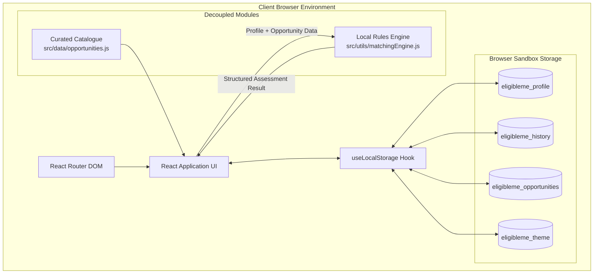
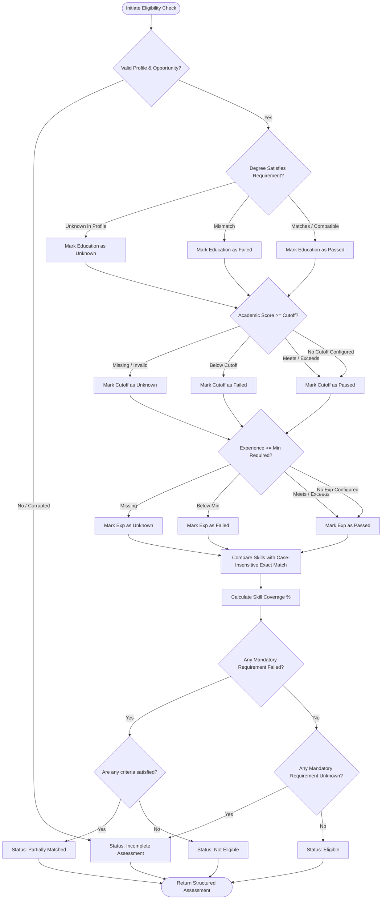

# EligibleMe — Candidate Eligibility & Skill-Matching Platform

EligibleMe is an open-source, client-side eligibility evaluation and skill gap assessment platform engineered for students, graduates, and job seekers. 

It provides transparent, instant answers to three fundamental career questions:
1. **Am I eligible for this role, internship, or scholarship?**
2. **Which mandatory criteria do I already fulfill, and which are missing?**
3. **What specific skills should I learn first to unlock the most opportunities?**

Unlike opaque recruiting systems or keyword scrapers, EligibleMe executes a deterministic, local rules engine directly in the browser—providing explainable breakdowns without external services, cloud server latency, or unnecessary data sharing.

---

## Table of Contents

- [Problem Statement & Objectives](#problem-statement--objectives)
- [Key Features](#key-features)
- [Technology Stack](#technology-stack)
- [Architecture & Data Flow](#architecture--data-flow)
  - [System Architecture Diagram](#system-architecture-diagram)
  - [Eligibility Evaluation Flowchart](#eligibility-evaluation-flowchart)
- [Rules Engine Formulas & Status Definitions](#rules-engine-formulas--status-definitions)
- [Project File Structure](#project-file-structure)
- [Getting Started & Local Development](#getting-started--local-development)
  - [Prerequisites](#prerequisites)
  - [Installation](#installation)
  - [Development Server](#development-server)
  - [Running Unit Tests](#running-unit-tests)
  - [Building for Production](#building-for-production)
- [GitHub Repository Setup](#github-repository-setup)
- [Vercel Deployment Guide](#vercel-deployment-guide)
- [Application Screenshots](#application-screenshots)
- [Data Storage & Privacy](#data-storage--privacy)
- [Sample Data Disclaimer](#sample-data-disclaimer)
- [Known Limitations & Future Enhancements](#known-limitations--future-enhancements)
- [Contribution Guidelines](#contribution-guidelines)
- [License](#license)

---

## Problem Statement & Objectives

### The Problem
College students and fresh graduates regularly spend hours combing through job postings, campus placement notices, and fellowship applications without a clear method to verify whether their qualifications satisfy strict cut-offs. Common hurdles include:
- Unclear distinctions between hard mandatory cut-offs and preferred skills.
- Confusion when converting between 10-point CGPA, 4.0 GPA, and percentage marks.
- Overestimating chances based on surface buzzwords while missing a fundamental qualification.
- Lack of actionable direction on which skills offer the highest return on study time.

### Objectives
- **Zero Ambiguity:** Compute verifiable eligibility status using explicit criteria.
- **Explainable Decisions:** Distinguish mandatory requirements from preferred qualifications.
- **Local & Private:** Zero backend server requirement; user profiles and evaluation history stay in client-side storage.
- **Interview-Ready Code Quality:** Clean component architecture, decoupled rules engine, automated Vitest coverage, and accessible design.

## Key Features

- **Local Resume Auto-Extraction (`resumeParser.js`):** In-browser resume document parsing supporting PDF, TXT, and Markdown files. Automatically extracts candidate name, email, degree level, specialization, institution, graduation year, CGPA/percentage, and technical skills with without external services or uploading resume contents to a server.
- **Candidate Profile Management:** Manage academic credentials (degree, graduation year, CGPA/percentage, grading scale), years of experience, and interactive technical skills tag picker with instant validation.
- **Curated Opportunity Catalogue:** Explore opportunities across Software Development, Java Development, Frontend Development, Data Analytics, Graduate Trainee Programmes, Internships, and Scholarships.
- **Deterministic Rules Engine (`matchingEngine.js`):** Independent JavaScript evaluation module with multi-scale academic grade normalization, degree compatibility mapping, and exact case-normalized skill matching.
- **Skill Match & Gap Analysis:** Dedicated inspection showing matched skills, missing required skills, additional candidate skills, and catalogue-wide high-demand learning priorities.
- **Immutable Assessment Audit Log:** Store evaluation snapshots containing candidate qualifications and opportunity requirements at the exact time of verification.
- **Dynamic Analytic Dashboard:** Real-time metrics showing true profile completion percentage, opportunity outcome distributions, responsive charts (via Recharts), and prioritized next steps.
- **Theme Persistence & Local Storage Safety:** Seamless light and dark mode with persistent user preferences, safe JSON parsing, and destructive data controls with confirmation dialogs.

---

## Technology Stack

| Layer | Technology | Purpose |
| :--- | :--- | :--- |
| **Framework** | React 19 | Component-driven UI architecture |
| **Build Tool** | Vite 8 | Ultra-fast local dev server and optimized rollup bundling |
| **Routing** | React Router v7 | Single-page client-side application navigation |
| **Styling** | Tailwind CSS v4 | Utility-first typography, layout, and dark mode |
| **Icons** | Lucide React | Lightweight, accessible SVG icon library |
| **Visualizations** | Recharts | SVG chart components for eligibility breakdown |
| **Test Runner** | Vitest | High-speed unit test runner for the rules engine |
| **Persistence** | W3C LocalStorage API | Resilient client-side state storage via custom hooks |
| **Hosting** | Vercel | Production edge CDN hosting with SPA rewrite rules |

*Note: EligibleMe runs in the browser and does not require a backend server or external database.*

---

## Architecture & Data Flow

### System Architecture Diagram



### Eligibility Evaluation Flowchart



---

## Rules Engine Formulas & Status Definitions

The matching engine is housed in `src/utils/matchingEngine.js`. It runs independently of React and contains no DOM or network side-effects.

### 1. Skill Coverage Formula
$$\text{Skill Coverage} = \frac{\text{Matched Required Skills}}{\text{Total Required Skills}} \times 100$$
*If an opportunity configures zero required skills, coverage defaults to 100% without division-by-zero.*

### 2. Weighted Requirement Coverage Formula
When evaluating holistic fit, assessable criteria are weighted as follows:
- **Mandatory Skills:** 40%
- **Qualifying Degree:** 25% (when specified)
- **Academic Score Cut-off:** 20% (when specified)
- **Minimum Experience:** 15% (when specified)

*If an opportunity does not require experience or cut-off scores, weights dynamically normalize over the applicable criteria to maintain an accurate 100% scale.*

### 3. Academic Grade Normalization
- **10-Point Scale:** Converted via standard AICTE/UGC multiplier ($\text{CGPA} \times 9.5$).
- **4.0 Scale:** Converted via $(\text{GPA} / 4.0) \times 100$.
- **Percentage:** Evaluated directly (capped at 100%).

### 4. Status Categories
| Status | Definition |
| :--- | :--- |
| **Eligible** | All configured mandatory requirements (degree, score, experience, and skills) are satisfied. |
| **Partially matched** | Some requirements are satisfied, but one or more mandatory requirements remain unfulfilled. High skill coverage **never** overrides a failed mandatory cut-off. |
| **Incomplete assessment** | Key candidate details (e.g., degree or academic score) are missing from the profile, preventing a reliable decision. |
| **Not eligible** | One or more mandatory requirements are confirmed unmet and zero baseline criteria are fulfilled. |

---

## Project File Structure

```
eligibleme/
├── public/
│   └── favicon.svg                  # Brand SVG favicon
├── src/
│   ├── components/
│   │   ├── AppLayout.jsx            # Shell layout with sidebar & header
│   │   ├── Sidebar.jsx              # Responsive navigation drawer
│   │   ├── Header.jsx               # Top navigation with theme toggle
│   │   ├── StatCard.jsx             # KPI analytical metric card
│   │   ├── StatusBadge.jsx          # Color-coded eligibility outcome pills
│   │   ├── OpportunityCard.jsx      # Opportunity catalogue card
│   │   └── EmptyState.jsx           # Actionable empty and onboarding states
│   ├── pages/
│   │   ├── Dashboard.jsx            # Overview KPI analytics & charts
│   │   ├── Profile.jsx              # Candidate profile form & validation
│   │   ├── Opportunities.jsx        # Searchable opportunity catalogue
│   │   ├── EligibilityChecker.jsx   # Core assessment engine UI
│   │   ├── SkillMatch.jsx           # Skill gap analysis & learning priorities
│   │   ├── History.jsx              # Assessment snapshot audit log
│   │   └── Settings.jsx             # Theme & local storage management
│   ├── data/
│   │   └── opportunities.js         # Curated sample opportunities
│   ├── hooks/
│   │   └── useLocalStorage.js       # Safe, synchronized LocalStorage hook
│   ├── utils/
│   │   └── matchingEngine.js        # Deterministic local rules engine
│   ├── test/
│   │   └── matchingEngine.test.js   # Vitest unit test suite (13 tests)
│   ├── App.jsx                      # Routing & shared state provider
│   ├── main.jsx                     # React root entry point
│   └── index.css                    # Tailwind CSS v4 entry
├── .gitignore                       # Git ignore definitions
├── index.html                       # HTML5 entry with meta & OpenGraph
├── package.json                     # Project manifest and scripts
├── README.md                        # Documentation
├── LICENSE                          # MIT License
└── vercel.json                      # Vercel SPA rewrite rules
```

---

## Getting Started & Local Development

### Prerequisites
- **Node.js:** v18.0.0 or higher
- **npm:** v9.0.0 or higher

### Installation

Clone the repository and install dependencies:

```bash
git clone https://github.com/your-username/eligibleme.git
cd eligibleme
npm install
```

### Development Server

Start the local Vite development server:

```bash
npm run dev
```

Open your browser at `http://localhost:3000` (or the port displayed in your terminal).

### Running Unit Tests

Run the automated Vitest test suite:

```bash
npm test
```

To run tests in watch mode during development:

```bash
npx vitest
```

### Building for Production

Compile optimized static production bundles to the `dist` directory:

```bash
npm run build
```

Preview the production build locally:

```bash
npm run preview
```

---

## GitHub Repository Setup

To push this project to a new GitHub repository:

```bash
# Initialize git if not already present
git init

# Stage all project files
git add .

# Create initial commit
git commit -m "feat: complete EligibleMe platform with local rules engine, tests, and ui"

# Link to your remote GitHub repository
git branch -M main
git remote add origin https://github.com/your-username/eligibleme.git

# Push code to GitHub
git push -u origin main
```

---

## Vercel Deployment Guide

EligibleMe is fully configured for direct deployment via GitHub on [Vercel](https://vercel.com):

1. **Push your code to GitHub** following the steps above.
2. Sign in to your [Vercel Dashboard](https://vercel.com/dashboard).
3. Click **Add New...** → **Project**.
4. Import your `eligibleme` repository.
5. In **Build and Output Settings**:
   - **Framework Preset:** Vite
   - **Build Command:** `npm run build`
   - **Output Directory:** `dist`
   - **Install Command:** `npm install`
6. **Environment Variables:** Leave empty (EligibleMe requires no secret keys or remote database URLs).
7. Click **Deploy**.

*Client-side routing on page refresh is automatically supported through the included `vercel.json` rewrite configuration.*

---

## Application Screenshots

> *Tip: After running the application, capture genuine screenshots from your local environment and replace the placeholder references below in your repository.*

| Dashboard & Outcome Distribution | Eligibility Checker Breakdown |
| :---: | :---: |
|  <br> *Overview KPI statistics & outcome chart* |  <br> *Detailed mandatory criteria verification* |

| Skill Match & Gap Analysis | Candidate Profile Configuration |
| :---: | :---: |
|  <br> *Exact-matched skill gaps & learning priorities* |  <br> *Local profile configuration with instant validation* |

---

## Data Storage & Privacy

- **100% Local Storage:** Candidate profiles, opportunity edits, and assessment histories are kept strictly inside the browser sandbox using the HTML5 `localStorage` API.
- **No Cloud Transmission:** No personal records, academic transcripts, or evaluations are transmitted to remote servers.
- **Device-Bound Scope:** Local data is tied to the specific browser and machine used. Clearing browser data or using incognito mode will wipe the local cache.
- **No Security Claims:** `localStorage` is not an encrypted credential store. Never input sensitive passwords, financial information, or government identification numbers.

---

## Sample Data Disclaimer

All company names, scholarship grants, criteria cut-offs, and external URLs included in `src/data/opportunities.js` are curated purely for illustrative demonstration. They do not constitute official hiring vacancies, corporate endorsements, or legally binding academic requirements. Final decisions always rest with the respective institution or employer.

---

## Known Limitations & Future Enhancements

### Known Limitations
- Skill comparisons utilize exact case-normalized token matching (`"React"` equals `"react"`). Related technologies (e.g., `"React"` and `"React Native"`) are treated as distinct skills.
- Multi-scale GPA conversions use standard linear and AICTE conversions; universities with non-standard proprietary grading policies should enter their equivalent percentage directly.

### Planned Enhancements
- Export assessment audit logs to printable PDF summary reports.
- Custom opportunity creator tool to allow users to evaluate ad-hoc job descriptions.
- Keyword synonym dictionary (e.g., linking "PostgreSQL" and "Postgres").

---

## Contribution Guidelines

Contributions are welcome! Please follow these steps:

1. Fork the project repository.
2. Create your feature branch (`git checkout -b feature/NewFeature`).
3. Ensure all unit tests pass (`npm test`).
4. Ensure the production build succeeds (`npm run build`).
5. Commit your changes (`git commit -m 'feat: Add NewFeature'`).
6. Push to the branch (`git push origin feature/NewFeature`).
7. Open a Pull Request.

---

## License

This project is licensed under the terms of the [MIT License](LICENSE).
